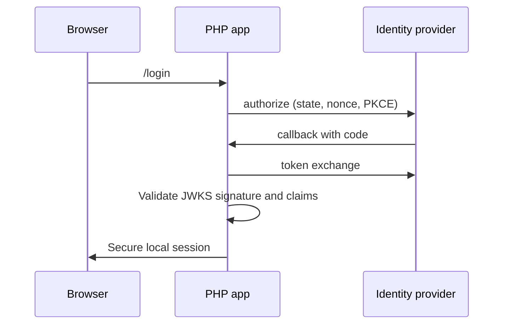

# Entra ID OIDC for PHP

Minimal, production-minded OpenID Connect login for PHP 8.2 applications, using Authorization Code + PKCE.



## Quick start

```bash
cp .env.example .env
# Edit .env with development credentials, then export values into your shell.
set -a
. ./.env
set +a
composer install
php -S localhost:8080 -t public
```

The sample reads environment variables via `getenv`; it does not load `.env` automatically. Never commit `.env` or share real credentials.

Set the redirect URI to `http://localhost:8080/callback.php` only for local development. See [App registration](docs/app-registration.md), [legacy integration](docs/legacy-integration.md), and [security checklist](docs/security-checklist.md).

## Security

The sample validates `state`, `nonce`, JWT signature via the provider JWKS, issuer, audience and expiry. Use HTTPS in every non-local environment and set a strong `APP_SESSION_NAME`.

## Roadmap

- Provider logout callback validation
- Redis-backed session store example

MIT License © William Lima
